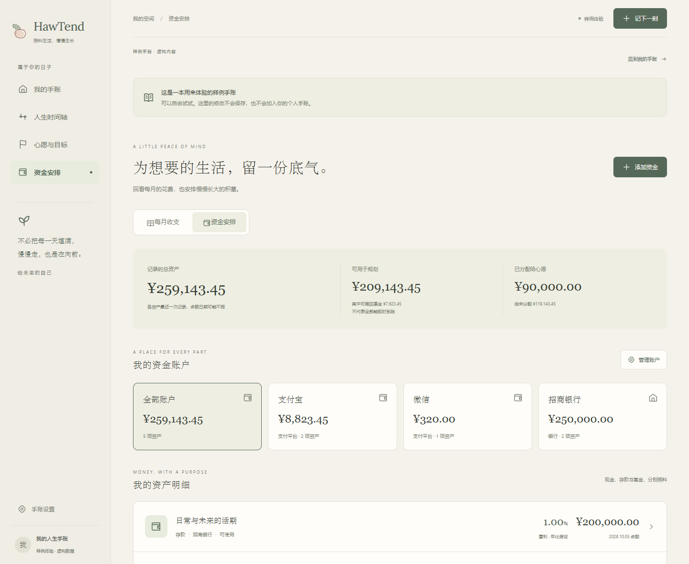
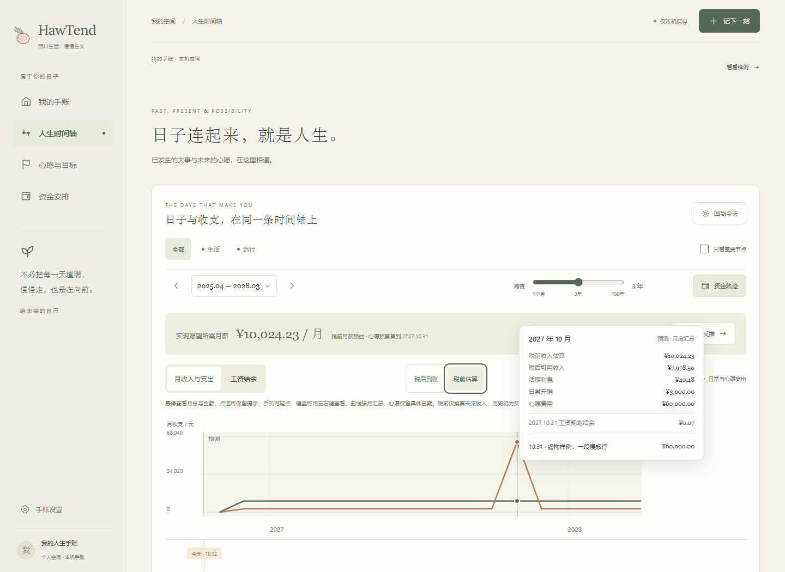

# HawTend · 人生手账

照料生活，慢慢生长。

HawTend 是一本把**值得记住的日子、未来想做的事和为它们准备的资金**放在一起的个人手账。温暖的纸色、手绘山楂和可拖动的时间轴，让记录与规划更接近日常生活。

**当前版本：v0.0.22，本地原型。** 可以在 Windows 上直接运行，也可以从源码在浏览器中使用。个人记录保存在本机；账号登录、云同步和 iPhone 在线安装仍在开发计划中。首页“留给自己的话”支持滚动阅读长感想；日子草稿自动保存、愿望预算反推月薪及共享人生时间轴继续保留。

[下载 Windows 版](https://github.com/Flying-Angels/HawTend/releases/tag/v0.0.22) · [从源码运行](#从源码运行) · [数据保存说明](#数据保存说明) · [后续计划](#后续计划)

## 现在可以做什么

| 页面 | 功能 |
| --- | --- |
| 我的手账 | 查看近期记录、心愿进度与资金概览；新手账从空白开始，也可以打开独立的虚构样例 |
| 人生时间轴 | 在同一条时间轴上查看已发生的事情与未来目标，拖动、按分类筛选；滑块从 1 个月非线性扩大到 100 年，中点为 3 年；点击日期范围设置起止月份 |
| 心愿与目标 | 写下期待、日期、分类与状态；可同时设置一次性费用和每月预算，按起止月份汇总费用 |
| 记下一刻 | 日子草稿随输入自动保存，关闭、刷新或重启后可继续写；支持加粗、斜体、下划线及 LaTeX 数学公式；设置日期、分类及重要程度，预览日期调整并撤销 |
| 资金安排 | 每月记录收入和支出；自定义平台、银行账户，记录现金、存款与基金；手动更新基金市值；把日常与心愿费用放进共享时间轴，试算期望月收入与余额 |
| 手账设置 | 自定义分类名称、颜色与图案，切换三种配色，导出 JSON 文件 |

<details>
<summary>展开界面预览（虚构样例，不是个人数据）</summary>








</details>

## Windows：下载后直接使用

日常使用推荐这个方式，**不需要安装 Node.js、下载源码或部署服务器**。

运行环境：**Windows 10 / 11 x64、.NET Framework 4.8、免费的 WebView2 Evergreen Runtime**。现在使用 HawTend 自己的窗口，正常启动不会打开 Edge 浏览器。多数 Windows 电脑已有运行时；缺少时应用会给出[微软官方下载入口](https://developer.microsoft.com/microsoft-edge/webview2/)。

1. 打开 [v0.0.22 下载页](https://github.com/Flying-Angels/HawTend/releases/tag/v0.0.22)，在 **Assets** 中下载 **`HawTend-v0.0.22-windows.zip`**。`Source code` 是源码，日常使用不需要下载它。
2. 将 ZIP **完整解压**到一个固定文件夹，例如 `D:\Apps\HawTend`。
3. 双击解压后的 **`HawTend.exe`**，开始使用。首次打开是空白手账；点击“看看样例”可以先试用功能。
4. 想从桌面打开：右键 `HawTend.exe` →“发送到”→“桌面快捷方式”。Windows 11 可先点击“显示更多选项”。若要指定透明图标，在快捷方式“属性 → 更改图标”中选择同目录的 `HawTend-transparent.ico`。

压缩包内包含程序、三个 WebView2 SDK DLL、透明图标、许可与使用说明。**请保留 DLL 与 EXE 在同一文件夹，完整解压并完整更新。** 页面资源内置，运行时只在本机提供页面，地址固定为 `http://127.0.0.1:4173/`。关闭窗口或从托盘退出会停止程序，重复启动回到已有窗口。

**更新方法：**先导出记录并退出旧版，再完整解压新版。已使用 v0.0.12 或之后独立窗口版本的手账会继续读取原来的记录，无需再次接续。从更早的浏览器版本升级时，第一次可点击“接续旧手账”：打开旧页面导出 JSON，回到新窗口选文件，确认后接续。旧浏览器记录保留，已有内容的手账不允许从此入口覆盖。也可从空白开始，之后在没有个人记录时从设置进入接续。

接续完成后，桌面记录保存在 `%LOCALAPPDATA%\HawTend\WebView2`，以后升级继续使用这个位置。请勿清理它。[独立窗口与接续说明](docs/22-独立Windows窗口与旧手账接续.md)提供完整步骤。

桌面版目前未做数字签名和自动更新。打包与页面资源已在开发电脑核对，其他电脑的运行情况仍需反馈。

## 从源码运行

适合开发、修改界面，或希望在浏览器中运行的人。**当前本地版不需要 Supabase 账号，也不需要配置 `.env`。**

### 1. 安装开发工具

- [Node.js 24 LTS](https://nodejs.org/en/download)，安装时保留 npm 和加入 PATH 的选项。已验证的 Node.js 版本是 `24.19.0`。
- [Git](https://git-scm.com/downloads)，用于下载与更新源码。

安装后重新打开终端，确认这些命令能显示版本：

```sh
node --version
npm --version
git --version
```

Windows PowerShell 如果提示 `npm.ps1` 无法运行，可以将下文中的 `npm` 写成 `npm.cmd`。

### 2. 下载、安装依赖、构建

```sh
git clone https://github.com/Flying-Angels/HawTend.git
cd HawTend
npm ci
npm run build
```

首次安装依赖需要联网。也可以在仓库页面选择 **Code → Download ZIP**，完整解压后在含有 `package.json` 的目录执行最后两条命令。

### 3. 打开应用

```sh
npm run preview
```

保持这个终端运行，在浏览器中打开 **http://127.0.0.1:4173/**。终端按 `Ctrl+C` 可以停止服务。页面首次成功加载后，离线缓存会保存应用资源；日常运行仍建议保留本机服务。

Windows 安装完依赖后，也可以双击项目根目录的 **`启动HawTend.cmd`**。它会按需构建、在后台启动预览并打开浏览器。直接双击 `index.html` 无法运行这个应用。

### 4. 自己生成 Windows EXE（可选）

在 **64 位 Windows** 上，完成依赖安装后执行：

```powershell
powershell.exe -NoProfile -ExecutionPolicy Bypass -File scripts/build-windows.ps1
```

脚本会构建页面、下载并校验固定版本的 WebView2 SDK，再使用本机 .NET Framework 编译器生成：

```text
releases/windows/HawTend.exe
releases/windows/HawTend-transparent.ico
releases/windows/Microsoft.Web.WebView2.Core.dll
releases/windows/Microsoft.Web.WebView2.WinForms.dll
releases/windows/WebView2Loader.dll
releases/windows/WebView2-SDK-LICENSE.txt
```

编译器缺失时需要先安装 .NET Framework 开发环境；直接使用下载页的 Windows 包不需要编译器。生成的程序不依赖项目源码或 Node.js。`releases/`、`dist/` 和依赖目录不会提交到 Git。

## 数据保存说明

- **桌面个人手账**保存在当前 Windows 用户的独立 WebView2 文件夹里；**浏览器版**保存在当前浏览器、当前网站地址的 IndexedDB 中。首次使用没有预填记录。
- **“看看样例”**使用虚构内容，修改只用于当次体验，不会写入个人手账。
- 更换设备、浏览器、浏览器配置文件或地址，会看到另一份本地手账。例如开发模式的 `5173` 端口与正式预览的 `4173` 端口分别保存数据。
- 复制 EXE、更新源码或公开 GitHub 仓库，都不会把浏览器中的手账上传或带到另一台电脑。
- 可以在“手账设置”导出 JSON，保留记录副本。空白桌面手账可手动接续导出的 JSON；不会覆盖已有内容。浏览器版尚无导入入口。清理对应浏览器网站数据或桌面记录文件夹会删除本地手账。
- 日子草稿单独保存在本机的 `localStorage`，正式手账 JSON 导出不包含草稿。可在“草稿箱”下载草稿 JSON 留存，当前没有直接导入草稿文件的入口。清理网站或应用数据也会删除草稿。

“今天”按设备本地日期显示，跨午夜及回到页面时自动更新。新记录默认使用当天日期，时间轴按真实日期定位圆点。浏览时间轴不会修改记录日期。

资金计算仍是原型试算：心愿的一次性费用可选做从今天开始的月末储蓄试算，持续费用单独显示，不计作需要攒齐的钱。固定年化资产从各自余额参考日推算，手动市值资产不套用年化。已有每月实际收入与支出结算，但没有逐笔记账、自动资金转账、账单文件导入或投资产品接入。新增储蓄默认按 0% 收益试算。

## 心愿与预算

打开 **心愿与目标 → 添加心愿**，填写想做的事、希望完成的日期、分类和说明。状态可以选“想做 / 进行中 / 已完成”。没有资金需求时，直接保存即可。

需要预算时，勾选 **一次性费用**、**每月持续费用**，或同时勾选两项。例如装备一次花 800 元，运动每月花 300 元，从 2026 年 10 月持续到 2027 年 6 月，预计总费用为 **800 + 300 × 9 = 3,500 元**。起止月份都按完整月份计入预算，不按天折算。

一次性费用下可以展开 **提前攒钱的试算**。它只把这笔费用按剩余月末存入次数拆分，默认新增储蓄年化为 0%，不扣除当前存款，不要求预留资金。持续费用是每月要花的钱，另行显示。实际收入与支出仍在“每月收支”填写，预算不会自动记成账单。

旧心愿的预算金额保留为一次性费用，需要按月投入时可以主动调整；不会自动猜测旧预算的含义。旧预留金额和数字进度保留在 JSON 记录中，不再参与当前计算或限制保存。日期调整仍先预览、确认后保存，并可撤销。详见 [心愿预算简化](docs/27-心愿预算简化.md)。

## 日期与月份选择

日子、心愿、资金余额、到期日和市值记录使用统一的手账风格日历；月度收支使用同风格的月份网格。点击日期字段打开面板，点击顶部年月可选月份、年份或直接跳年。选中后填入当前表单，仍需点击表单的保存按钮才写入记录。

灰色日期表示超出这个字段允许的范围；“选今天 / 选本月”可快速回到当前日期。支持方向键、Enter 和 Escape，手机尺寸下使用底部面板。原有的日期调整预览与撤销仍保留，详见 [统一日期与月份选择](docs/26-统一日期与月份选择.md)。

## 调整时间轴跨度

打开 **人生时间轴**，拖动“跨度”滑块：**最左 1 个月 → 中点 3 年 → 最右 100 年**。短范围占用更多滑动空间，便于查看相邻日子。缩放时优先保留屏幕上的今天；浏览其他时间时围绕当前视野缩放。

点击左侧日期范围，再点击“起始月份”或“结束月份”卡片，从月份网格中选择。点击年份可以打开年份网格或直接跳到指定年份；下方实时显示总跨度，点击“应用时间范围”才生效。也可快速选 1 / 3 / 6 个月或 1 / 3 / 10 / 100 年，见 [月份选择面板](docs/25-手账风格月份选择.md)。

范围包含起止月份，左右箭头按当前跨度翻页；“回到今天”保留所选跨度。刻度随范围切换为日、月或年，浏览不会改动记录。缩放规则与验证见 [非线性时间跨度与月视图](docs/24-非线性时间跨度与月视图.md)。

## 资金账户与基金市值

打开 **资金安排 → 资金安排**，先点“管理账户”，添加支付宝、微信、银行或具体银行卡。再点“添加资金”或已有资产，为它选择所在账户。一个账户可以同时有现金、存款、基金；账户总额由资产自动合计，不另外填一次余额。

基金选择 **资产类别：基金 → 收益记录方式：手动更新市值**，填当前金额和余额日期作为起点。之后点击 **“更新市值 / 盈亏”**，每月填写最新持有市值，或上次记录以来的盈利 / 亏损。期间有买入、赎回或现金分红时可展开补填，避免把追加资金算成收益。同日更正会替换旧记录，可撤销。

旧资金保留原金额和参考日期，显示为“暂未归到账户”，可以逐项设置，不会自动改成基金。金额精确到分，市值历史单独展示。资金摘要中的可规划金额包含可赎回基金，不表示即时到账；本版月薪反推独立使用未来工资，不抵扣任何现有资产。

市值更新和账户间转账不会自动写入月度收入、支出或其他现金余额。买入后减少闲置余额，赎回到账后更新接收账户，防止重复记录。完整口径与例子见 [资金账户与手动市值](docs/21-资金账户与手动市值.md)。

## 每月收支与提醒

打开 **资金安排 → 每月收支**，点击“补记上个月”或“记录一个月”，填写月份、实际收入和实际支出两个总额，备注可留空。可以补记历史月份、修改和撤销；同月更新会替换旧金额，不重复累加。

月结余不会自动增加资金余额。未投入的钱可点“记录未计息余额”，按实际余额设置 0% 年化；投入后相应减少日常余额，再记录新的计息资金。自己账户间转账不算消费。心愿预算与实际月收支分别记录。

首页与收支页会提示尚未补记的上个月。需要程序关闭时仍提醒，点“加入月初提醒”，下载并导入 ICS 到支持的日历：每月 1 日当地时间 10:00 提醒。**文件下载后仍需自行确认导入及日历通知权限，并未自动添加或启用通知。** 不需要部署提醒服务器；实际通知取决于日历客户端，手机日历导入尚未实机验证。

逐笔记账与支付宝、银行账单文件导入列在后续计划，当前不支持自动拉取个人账单。方案与计算口径见 [月度收支说明](docs/19-月度收支与月初提醒.md)。

## 从愿望预算反推月薪

在 **资金安排 → 资金安排** 顶部查看“实现这些愿望，月薪要多少？”。填入愿望预算和日期后，应用自动反推覆盖全部愿望与生活费的最低固定月薪，直接显示税前目标及对应税后到账额，不需要自填期望工资。

1. 为心愿填写一次性费用、每月费用与日期。一笔费用在对应付款日计入；月费用按开始至完成月份计入，已完成心愿不再扣费。
2. 展开“规划假设与收入换算”，核对每月日常开销。首次默认取最近一个已结束月份的实际支出；没有来源时显示只含愿望的月薪下限，并提示补填生活费。如果某项心愿月费用已包含在日常开销里，勾选标记，避免重复计算。
3. **现有存款全部保留，愿望靠未来工资实现。** 本金、原有资金收益、基金和定期到期金额均不抵扣。工资扣除费用后的新结余默认按 **0.8% 年化复利**试算，可修改；每个付款日都检查不能出现资金缺口，近期费用也会约束月薪。
4. 税前按中国大陆居民工资、全年均匀收入的年税平均估算；自行填写每月个人社保、公积金与专项附加扣除，默认均为 0。个人缴费减少到账额，专项附加扣除只减少计税金额，不重复当支出；未计入年终奖、其他所得或实际逐月预扣差异。[规则来源：税务总局](https://www.chinatax.gov.cn/n810219/n810744/n3752930/n3752974/c3970366/content.html)。
5. 下方列出“为愿望每月需留 + 日常开销 = 税后工资下限”，以及愿望清单、费用和最约束工资的付款日期。修改先预览，点“保存规划假设”才保存设置；不会改动真实账单、账户余额或心愿日期。

完整曲线只在 **人生时间轴 → 资金轨迹** 中展示，资金页“到时间轴查看曲线”会跳转并打开它。绿色实线使用算出的工资（加新结余利息），棕色实线是日常与心愿支出；切换“工资结余”查看付款后的规划余额。税前 / 税后只影响收入线，结余始终使用税后现金。

鼠标悬停曲线即显示月份、工资、利息、日常开销、心愿费用和结余，并列出具体心愿日期及金额。点选可保留提示，点图外或按 Escape 关闭；手机可轻点图面，键盘聚焦曲线后可用左右键切换月份。下方月份选择保留完整费用明细。

曲线与节点使用同一个拖动区域、月份范围和 **1 个月至 100 年** 的非线性滑块。缩放只改变浏览范围，收入测算仍覆盖所有未来预算，不会因为移出屏幕而漏掉心愿。历史收支来自月度记录，缺失月份不连接；未来区域有背景标记。

工资规划今天从 **0 元**起算；整月工资、日常与持续月费从下个月月初开始，本月只计未付款的一次性愿望。本月早于下次工资的费用显示缺口，请调整付款时间。“心愿预算算到”是最后一个未来预算日期，拖动与缩放不会改变工资目标。浏览之后的月份继续沿用已算工资与日常开销，并非心愿过期。**0.8% 是可编辑的规划假设，不是自动投资或真实收益。** 完整规则与例子见 [愿望预算反推月薪](docs/30-愿望预算反推月薪.md)。

## 草稿自动保存与续写

打开 **记下一刻 → 值得记住的日子**，开始输入后，标题、正文、感想、日期、分类、重要程度与格式源文会自动保存到本机。还没写标题也会保留文字。编辑器顶部显示保存状态；没有修改的空白表单不生成草稿。

误点外部、按 Escape 或关闭弹窗后，页面顶部会出现 **“还有 N 篇日子，等你继续写”**。点击“继续写”恢复，也可以从“草稿箱”选择多份草稿、下载副本或确认删除。刷新或重启后继续使用相同的本机手账空间即可续写。

点击 **“收进手账”** 才正式入册。编辑已有记录时，草稿也不会提前覆盖正式内容；成功保存后清理对应草稿，保存失败则继续保留。自动保存失败时会提示并阻止误关，可重试、下载文字或正式保存。样例体验不会写入个人草稿。

此功能从 **v0.0.21** 开始生效，无法补回旧版弹窗关闭前未保存的文字。当前覆盖日子编辑器，其他表单尚无草稿自动保存。操作与验证见 [草稿自动保存说明](docs/31-记下一刻草稿自动保存.md)。

## 文字格式与公式

首页 **“留给自己的话”** 超出卡片高度时，可在正文内使用滚轮、拖动右侧纵向滚动条，或聚焦后用键盘上下键 / Home / End 阅读完整内容。滚动、选择文字不会打开编辑；点击卡片底部标题或右上角编辑按钮进入详情。短感想自然显示，不额外撑长卡片。见 [长感想滚动阅读](docs/32-留给自己的话滚动阅读.md)。

“发生了什么”和“留给自己的话”均提供 **编辑 / 预览** 两种视图。选中文字，点击工具栏的 **B、I、U**，或按 `Ctrl+B`、`Ctrl+I`、`Ctrl+U`（Mac 使用 `⌘`），即可插入加粗、斜体、下划线格式。`Ctrl+Z` 撤销，`Ctrl+Shift+Z` 重做。编辑时显示语法，点击“预览”看到排版效果。

- 行内公式：`$x^2$`、`$\frac{a}{b}$`。
- 独立公式：用单独占行的 `$$` 包住公式；也可点击 **∑** 工具插入模板。
- 支持 Markdown 列表、引用和链接；普通换行会在预览中保留。
- 公式使用 KaTeX 支持的 LaTeX 数学语法，不支持完整 `.tex` 文档或自定义宏包。字体与渲染器已内置，可离线使用。
- 旧记录仍按普通文字显示；点击工具或“启用格式”才开始解析语法。源文随记录保存并包含在 JSON 导出中。普通美元符号在格式模式下可写成 `\$`。

## iPhone 和云同步

手机布局、PWA 清单与离线缓存已经准备好，但**目前没有已发布的在线网址，Windows 与 iPhone 尚不能同步**。手机不能通过电脑的 `127.0.0.1` 地址访问应用。

计划先提供 HTTPS 在线版，让 iPhone 使用 Safari“添加到主屏幕”，再接入登录和云同步。这个路线使用 PWA，无需以原生 iOS App 的方式发布。云端计划采用免费额度内的托管服务，个人数据与 GitHub 源码分开保存；你不需要自己维护服务器。

支付宝个人消费流水、Apple 健康数据和体检报告分析均未接入，不能把这些当作当前版本的功能。

## 开发与检查

客户端使用 React、TypeScript 和 Vite；本地数据使用 IndexedDB。Windows 桌面窗口由 C# / WinForms 提供，通过 WebView2 显示共用页面。`src/cloud/` 与 `supabase/` 中已有同步适配器、迁移和权限测试草案，尚未接入实际应用。

```sh
npm run dev            # 开发模式，终端显示访问地址
npm run build          # 类型检查、生产构建、生成离线缓存
npm run check:finance  # 资金计算边界检查
npm run check:cashflow # 心愿付款时序、0.8% 复利、所需月收入与现金流检查
npm run check:income   # 税前年税估算、个人扣除、税后反推与旧设置兼容检查
npm run check:salary   # 愿望预算反推工资、存款排除、付款时序与计算依据检查
npm run check:drafts   # 日子草稿恢复、保存失败、清理和坏数据保留检查
npm run check:goals    # 一次性与月度心愿预算、状态兼容检查
npm run check:assets   # 账户归属、市值盈亏与同日更正检查
npm run check:cloud    # 本地同步协议与数据校验检查，不连接云数据库
npm run check:monthly  # 月结算、旧数据兼容与月初日历事件检查
npm run check:calendar # 当地日期、午夜和跨年检查
npm run check:timeline # 非线性跨度、精确月份、闰年和刻度检查
npm run check:picker   # 日历网格、闰日、换月和日期边界检查
```

```text
src/        页面、样式、本地数据与资金计算
public/     品牌图标、PWA 清单与字体授权
windows/    Windows 启动器源码
scripts/    构建、打包、预览与检查脚本
supabase/   后续云同步的迁移和权限测试草案
docs/       需求、技术方案与历次设计开发记录
```

## 后续计划

1. 完成 HTTPS 托管、账号登录、Windows / iPhone 云同步与实机验证。
2. 完善收支与规划体验、数据导入恢复及提醒。
3. 逐步加入可选逐笔记账、账单文件导入、健康档案与报告导入。

详细范围见 [需求与分期计划](docs/01-需求与分期计划.md) 和 [技术选型与接入边界](docs/02-技术选型与接入边界.md)。`docs/` 也保留阶段开发记录，其中本机截图和构建产物位于未提交的目录，不是公开下载入口。

HawTend 字标使用 Lora，公式使用 KaTeX 及其内置字体。授权见 [字体说明](public/brand/font-licenses/README.md)、对应 OFL 文件及 [KaTeX MIT 许可](public/brand/font-licenses/KaTeX-MIT.txt)。
