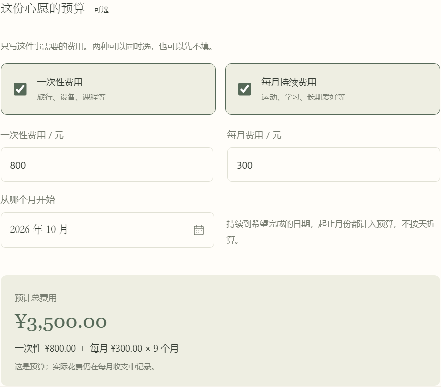
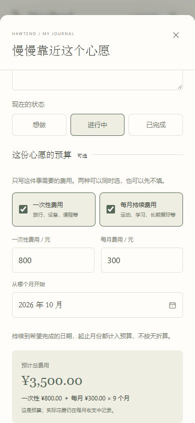

# 心愿预算简化

日期：2026-10-11 · 版本：v0.0.17

后续 v0.0.18 已把心愿预算接入全局收支、共享时间轴与期望月收入试算，见 [共享时间轴与收入试算](28-共享时间轴与收入试算.md)。本页中的心愿表单继续保留，全局日常开销只在资金规划中设置。

用户明确：心愿的重点是想做的事及其费用。日常生活开销、固定负担属于记账；心愿可以同时有一次性费用与每月持续费用。“预留资金”当前没有清晰作用，应去掉。本次调整覆盖先前文档中的目标预留、数字进度和单目标收入表单设计。

## 使用方式

心愿保留名称、日期、分类、说明，状态使用“想做 / 进行中 / 已完成”。预算可留空；不要求资金金额或主观百分比。

需要预算时勾选一次性费用、每月持续费用，或同时勾选两者。每月费用另设开始月份，持续到心愿的希望完成日期，按完整自然月预算，起止月份均计入。开始月份不能晚于完成月份。金额精确到分。

虚构例子：800 元装备 + 每月 300 元运动费用，从 2026 年 10 月到 2027 年 6 月，9 个月，预计总费用 3,500 元。列表同时标明“一次性 ¥800.00 · 每月 ¥300.00”，时间轴显示每月费用时附“/月”，状态用文字说明。

一次性费用提供默认折叠的“提前攒钱的试算”：从今天起按可发生的月末存入次数估算，默认年化 0%；只对一次性费用计算，持续费用另计。它不扣除现有资产或历史预留，不声称所需总收入，也不自动投资。

日常开销、额外负担、所需可支配收入和预留资金字段从心愿中移除。资金摘要中的“已分配给心愿”改为“暂不可用”，依据到期与可赎回状态汇总。

## 数据与兼容

- 未保存的查看、切换预算选项、日期选择与计算，不写入手账。
- 心愿预算不会自动生成真实月账单、减少账户余额、添加收益或转账。
- 旧预算保留为一次性金额，用户可明确改为每月金额；不将旧总额自动除以月数。
- 旧 `allocatedCents` 和 `progress` 保留，当前界面不再展示或用于计算、预算校验。只在未有明确状态时，按旧进度 0 / 中间值 / 100 显示想做 / 进行中 / 已完成；读取不改写旧记录。
- 新字段 `status`、`monthlyBudgetCents`、`monthlyStartMonth` 可选，保持原有 schemaVersion、数据库、记录 ID 与桌面数据目录。
- 保存状态后明确状态优先，旧百分比仍保留；去掉预算不会因旧预留金额阻止保存。
- 日期调整预览会重算预算与可选储蓄金额；确认后才保存，最近一次修改可撤销。

## 验证与界面

`npm run check:goals` 核对混合预算、跨年及闰月、起止月包含、纯持续费用不计作储蓄、近日期提示、旧数据兼容、非法月份和金额精度。`check:cloud` 在本地验证共享 JSON 格式，不连接或修改云端。

Playwright 在独立端口、虚构手账中核对新建、编辑、重载、预览日期、保存与撤销；确认原资产和月收支没有变化。验证 320 / 390 / 768 / 1440 宽度无横向溢出，状态及预算选项触控区域至少 44 像素。Windows 使用独立的 WebView2 测试目录验证打包后的表单与月历。没有读取真实个人手账；手机仅验证浏览器尺寸，尚未验证 iPhone 实机。

