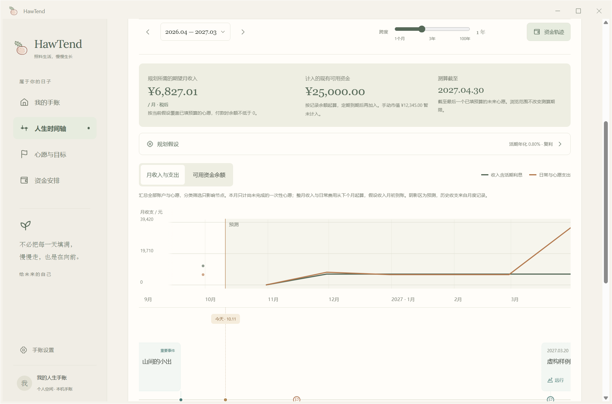
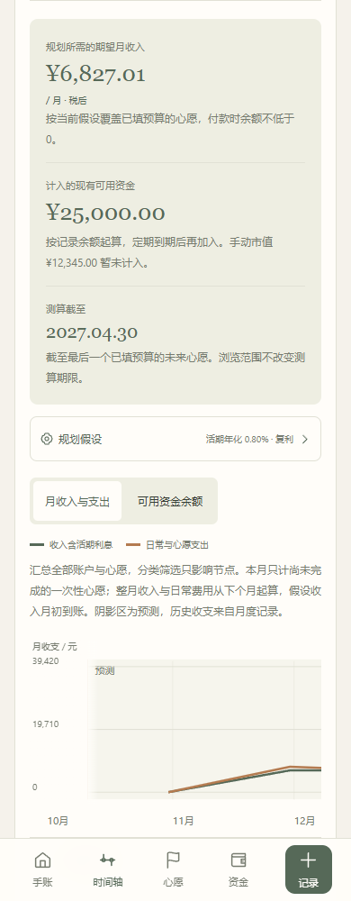

# 共享时间轴与收入试算

日期：2026-10-11 · 版本：v0.0.18

v0.0.19 后续调整：完整曲线仅在人生时间轴展开，资金页顶部保留收入测算及跳转入口，加入税前 / 税后换算、就近悬停明细，并重写预算日期之后的提示。当前页面操作见 [收入测算与曲线明细](29-收入测算与曲线明细.md)；本页保留 v0.0.18 的计算口径与记录。

原先的十年图只推算资产收益，没有加入心愿费用与未来收入。本版改为收支、可用余额和人生节点共用时间范围，落实用户要求的实线、可拖动跨度及默认 0.8% 活期复利下的期望月收入。此前文档中的独立十年资产图由本页方案替代；不恢复心愿预留字段。

## 页面与操作

资金安排页资产明细下直接展开共享时间轴；人生时间轴点“资金轨迹”也能打开。同一横向滚动区域包含上方曲线与下方日子 / 心愿节点，日期、刻度、今天标记使用同一映射。拖动背景、键盘左右键或触摸横向滚动同时移动两者；缩放和起止月份编辑沿用已完成的 1 个月—3 年—100 年非线性规则，两页共享浏览范围。

默认显示两条实线：每月税后收入加活期试算利息、每月日常开销加心愿费用。曲线的点为月度汇总，节点仍在具体日期。可切换到单独的可用现金余额曲线，避免把月度流量与累计余额混作同一种金额。纵轴数值在横向拖动时保留。

过去的收支取实际月结记录，缺失月份断开，不编造历史余额。今天以后的区域有背景标记，使用规划值。月份详情列出收入、活期利息、日常开销、心愿费用与余额；有定期到期时单列资金释放，不再算成薪资收入。心愿费用列出名称及一次性 / 当月金额。自填收入造成的付款缺口明确展示。

节点分类、重要程度和账户筛选只影响展示，不把其他心愿和资金从全局测算中删掉。打开现金流时优先展示今天附近的未来；浏览历史范围仍可查看实际收支。

## 预算、收入与资金的口径

- 未完成、日期不早于今天的心愿参与未来计划。一次性费用在心愿日期扣除；每月费用从设置的开始月份到完成月份按完整月计入，起止月份都包含。已完成的心愿不再付款。过期未完成预算和未填预算的未来心愿有提示，不自动改日期或猜金额。
- 现有可用资产按最近记录余额作为今天的起点，不重新累计已记录的利息。定期资产保留原计息配置，到期日释放本金和按配置算出的收益；到期前不拿它支付心愿。到期资金作为可用资金转入，不算第二笔薪资。
- 手动市值资产默认排除，界面列出未计入金额。明确勾选后，可用或已到期的手动资产假设按记录市值兑换为现金；不预测基金涨跌或赎回到账过程。
- 每月日常开销首次默认引用最近一个已结束月份的实际支出。保存后使用独立的规划假设，后续记账不会悄悄覆盖设置。已包含在日常开销里的心愿月费用可逐项勾选，不再重复相加；一次性心愿预算不因该勾选而免除。
- 本月整月薪资、日常开销与心愿月费用不再次累计，因为最新余额可能已经包含本月已发生的收支。从下个月起，假设每月 1 日先收到收入，再支付日常与持续费用。本月未完成的一次性心愿仍在其日期扣除。未细分本月尚未发生的日常或持续费用，用户应据此核对起点余额。
- 全局现金统一按所设活期年化复利增长，默认 0.8%；定期在到期前保持原配置，之后并入现金。该假设不会将实际闲置现金自动投资，也不覆盖资产原配置。
- 默认曲线使用求得的固定税后月收入，可改为自填收入做比较。自填值只影响曲线，不取代“规划所需的期望月收入”。未来物价与工资按输入的固定值，当前未加入通胀、税率推算或收益波动。

## 期望月收入的算法

测算期限取所有已填预算的未来心愿中的最后日期；没有这些预算时，取本月之后第 12 个月的月末。这个期限独立于当前浏览范围，不能通过缩小范围漏掉长期目标。超过期限的图继续按同一收入与开销延伸，但所求最低收入仅保证测算期限内的付款约束。

在任意两个日期间，现金按有效年化和实际天数增长：

```text
增长倍数 = (1 + 年化 / 100) ^ (间隔天数 / 365)
余额 = 原余额 × 增长倍数 + 到期转入 + 税后收入 − 日常费用 − 心愿费用
```

按日期排列到期、收入与付款，同一天先转入资金和收入，再付款。将每个付款时点的余额表达为 `A + B × 固定月收入`。取所有时点所需收入下界的最大值，向上取整到分。检查每个付款日期，不能因为某笔定期以后到期、最后余额为正就忽略前面的缺口。若下次收入前已有缺口，显示本月需要补足的金额，不给出一个虚假的未来收入来解决过去付款。

已有资金足以覆盖期限内全部费用时，最低固定月收入可以是 0；这不表示之后生活不需要收入。选择自填收入时，对负余额不虚构负债利息，直接显示缺口。

虚构验证例子：2026-10-11 现有现金 25,000 元、2027-03-10 到期的 5,000 元定期（原年化 5%）、另有未纳入的手动基金市值 12,345 元。日常每月 6,500 元；11 月装备 1,500 元、次年 3 月旅行 30,000 元、11 月至次年 4 月运动每月 350 元加 4 月一次性 800 元。活期年化 0.8%，测算截至 2027-04-30，所需月收入为 7,177.01 元。若运动月费用已包含于日常 6,500 元，勾选后为 6,827.01 元。此例只用于验证，不是用户的个人收入建议。

## 保存与兼容

可选 `financialPlan` 保存日常开销、年化假设、可选自填月收入、手动资产是否计入、已包含月费用的心愿 ID。沿用 schemaVersion 1、原数据库和桌面记录目录。旧手账没有此字段时动态生成默认值；读取不改写记录。

查看、缩放、筛选、切换曲线和试改假设不保存；“保存规划假设”才写入设置，不改动真实账单、资产、预算与日期。JSON 导出 / 接续保留设置并校验内容。包含已保存假设的旧手账不能再被识别为未编辑样例而清空。独立样例的设置只保留在本次体验，不加入个人手账。

## 验证与范围

新增 `npm run check:cashflow`：混合预算、月费重复、完成状态、本月缺口、早期付款约束、定期同日 / 延后到期、手动资产排除与明确计入、0.8% 复利、独立贴现公式交叉核对、超过十年的目标、浏览范围不改变收入建议、月收支汇总、旧数据兼容及不修改输入记录。其余资金、资产、心愿、月结、时间范围、日期与本地格式检查通过，生产构建通过。

Playwright 使用独立端口和虚构记录，验证日期轴逐点一致、图与节点共同拖动、键盘滚动、实线、历史缺失断开、月度费用明细、规划保存重载、排除重复费用、手动市值选择、自填收入缺口、1 个月 / 100 年边界及跨页共用范围。核对前后资产、心愿、实际月结不变，320 / 390 / 768 / 1440 宽度无页面横向溢出。

Windows v0.0.18 使用独立测试目录实际运行打包后的 WebView2 窗口，验证上述交互、截图及关闭；未读取用户真实手账。手机验证为浏览器尺寸，iPhone 实机与云同步仍未接入。本版不部署云端或新增付费服务。




