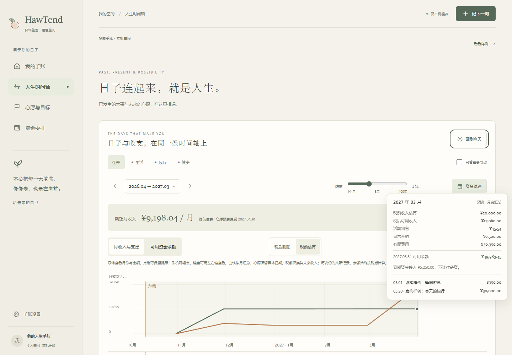
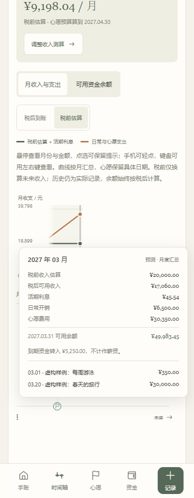

# 收入测算与曲线明细

日期：2026-10-12 · 版本：v0.0.19

这次修正用户指出的四个基础问题：只有税后视图、悬停没有就近金额、预算期限提示难理解，以及资金页重复完整人生时间轴。

## 页面职责与收入目标

资金安排页默认打开资产视图，收入目标卡片放在总资产、账户和资产明细之前。卡片能切换“税后到账 / 税前估算”，显示所需收入、另一口径的对应金额、现有可用资金与“心愿预算算到”的日期。没有日常开销来源、也未明确保存该假设时，先显示“先补充日常开销”，点击按钮展开设置并聚焦费用输入；不会把只含心愿费用的零收入当作完整目标。试填有效开销后立刻预览收入。

完整可拖动时间轴只放在人生时间轴页面，保留“资金轨迹”开关。资金页“到时间轴查看曲线”跳转并展开；时间轴上方保留紧凑的收入目标与“调整收入测算”入口，返回资金页设置。两页共用同一份未保存的试算假设，实际账单与资产各自保留；资金页没有第二条完整时间轴。首页原有节点概览继续用于回看日子。

## 税前与税后

按中国大陆居民工资收入、全年每月均匀工资估算。采用当年综合所得税率表，全年减除费用 60,000 元，并扣除用户填写的个人社保、公积金和专项附加扣除。规则核实日期为 2026-10-12，来源为 [国家税务总局《中华人民共和国个人所得税法》](https://www.chinatax.gov.cn/n810219/n810744/n3752930/n3752974/c3970366/content.html) 与 [税务总局扣缴办法解读及税率表](https://www.chinatax.gov.cn/chinatax/n810214/n810641/n2985871/n2985888/n2986028/c4001080/content.html)。

```text
全年计税金额 = max(0, 12 × (税前月收入 − 个人月缴费 − 月专项附加扣除) − 60000)
全年估算个税 = 全年计税金额 × 对应税率 − 速算扣除数
税后月可用收入 = 税前月收入 − 个人月缴费 − 全年个税 / 12
```

个税与月均税额按分四舍五入。税后目标反推税前工资时，用单调搜索找到满足所需净额的最低税前金额，精确到分；超出当前输入上限时显示需要另行估算。个人缴费减少现金到账，并作为税前专项扣除；专项附加扣除只减税基，不再减一次到账资金。缴费与扣除默认均为 0，不猜城市比例、缴费基数或资格，用户填个人实际金额 / 可扣除额。

这是年税平均估算，未计算每个月的累计预扣差异、年终奖、其他综合所得、非居民个税或后续税法变化。未来规划沿用当前规则假设，不能当作真实工资单或报税结果。

自填收入可按税前输入，换算得到税后现金；修改缴费或扣除时跟随重算。切换显示口径保持税后现金不变。税前曲线只换算未来工资收入，不把已有实际月结反算成税前，也不把活期利息并入工资计税。可用余额始终使用税后净额，原 0.8% 现金流与付款时点计算不改。

## 曲线检查与月份日期

鼠标悬停在图面即显示就近卡片：月份、实际 / 预测、收入、活期利息、日常开销、心愿费用与余额。有定期到期时单列转入金额，不重复当工资。卡片列出最多三项心愿的具体付款日期与金额，更多项目仍在下方月份明细查看。十字线和圆点标示对应月汇总位置。

卡片在浏览器窗口内显示，横向滚动容器不裁掉它，边缘时自动换位置。鼠标点选或手机轻点可保留提示，点击图外、按 Escape 或页面滚动后关闭；拖动过程中不弹出。键盘聚焦图面后用左右键查看月份，Enter 保留提示，Escape 关闭。历史缺失月份显示“未记录”，不编造余额；余额图的今天起点显示记录余额，不误标成月末预测。

“心愿预算算到”是最后一个已填预算的未来心愿日期，不代表心愿过期或曲线不能继续浏览。之后的月份只提示“继续按相同收入与日常开销试算”。月份与预算结束月相同时不显示结束提示，避免月末汇总日期晚于月中付款日引发误报。真正的逾期未完成心愿与实际付款缺口仍分别提示。

## 数据与验证

`financialPlan` 新增可选 `incomeBasis`、`grossMonthlyIncomeCents`、`salaryDeductions`。原 `monthlyIncomeCents` 始终是税后现金，老版本设置不改含义。导出与接续校验金额、口径和扣除；同时保存税前、税后输入时校验两者一致。点击保存才写入规划假设，不改实际月结、资产、心愿或日期；样例不写入个人记录。

新增 `check:income` 核对七档税率边界、60,000 元费用、个人扣除、金额舍入、税前反推、旧口径和非法设置。其余九组资金、账单、日期与格式检查及生产构建通过。

Playwright 在隔离端口和虚构记录中核对：资金页收入卡片位置、无重复时间轴、跳转开启曲线、税前输入及净额、保存重载且实际数据不变、悬停月份和具体费用、提示卡不裁切、点选保留与 Escape、键盘月份、切换税前不改变余额、预算之后的中性说明及缺失开销补填。320 / 390 / 768 / 1440 宽度无页面横向溢出，Chromium 触控模拟验证轻点明细。Windows WebView2 打包版采用独立测试目录验证上述主流程与关闭，没有读取用户真实手账。手机为尺寸和触控模拟，尚未验证 iPhone 实机。





