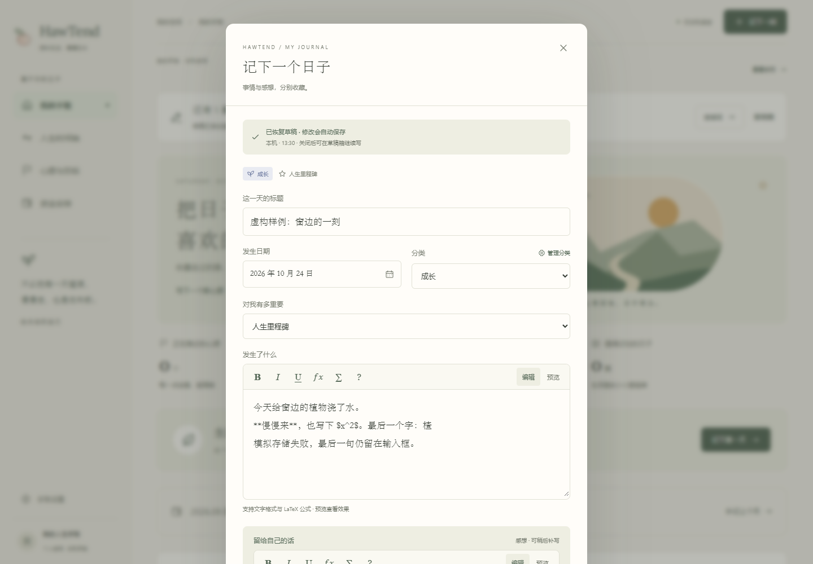
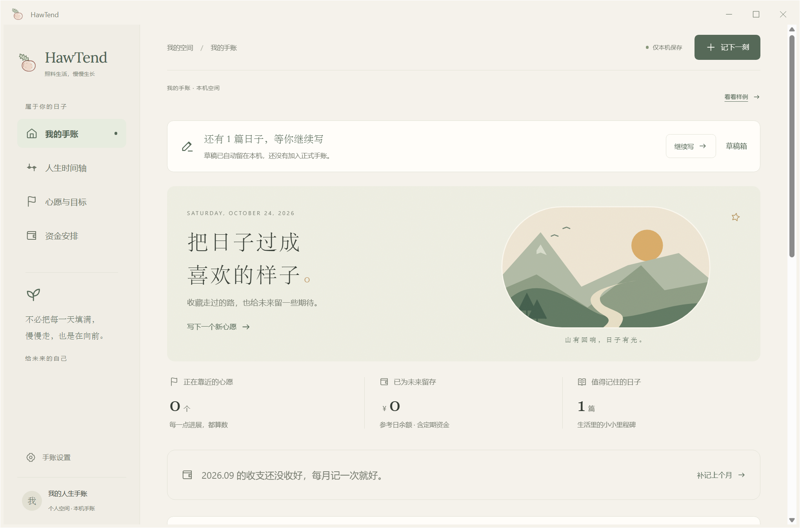

# 记下一刻：草稿自动保存与恢复

日期：2026-10-24 · 版本：v0.0.21

“记下一刻 → 值得记住的日子”新增独立草稿保存。新日子和已有大事记的修改都适用，正文、感想、标题、日期、分类、重要程度和 Markdown / LaTeX 源文一同保留。

## 使用方式

- 输入或修改内容时自动保存到本机，编辑器顶部显示保存状态和时间。没有输入的空表单不生成草稿；只写正文、还没有标题也能保存草稿。
- 点击外部、按 Escape 或点关闭按钮之后，页面上方显示“还有 N 篇日子，等你继续写”。点击“继续写”恢复；多份草稿在“草稿箱”中选择。“记下一刻”菜单也提供草稿入口。
- 刷新页面或关闭 Windows 程序后，再从相同的本机手账空间打开，仍可继续草稿。不同浏览器、不同端口或其他设备不会自动共享草稿。
- 点击“收进手账”才正式入册。已有记录在确认前维持原内容，草稿不会提前移动时间轴节点。调整已有记录的日期仍需要预览和确认。
- 草稿箱可以下载 JSON 留存，删除时需要明确确认。正式手账 JSON 导出不包含草稿，下载的草稿目前用于单独留存，尚无直接导入入口。

草稿功能从 v0.0.21 开始生效。旧版弹窗关闭前没有写入的文字，不会因升级而补回；不能把新的自动保存称为恢复了旧版丢失内容。

## 保存可靠性

保存直接发生在输入事件处理过程中，不依赖延迟计时器、失焦或卸载弹窗。关闭弹窗前再次确认保存，页面转入后台时也补写。写入成功才显示“已自动保存”。本机存储被禁用或空间不足时，显示失败状态，保留输入框中的最新文字并阻止误关，提供重试、下载当前草稿或正式保存入口；不会悄悄退回较早内容。

正式保存失败时草稿继续保留。正式保存成功后只清理对应且内容相符的草稿；若正式写入期间又输入了新文字，这些新文字不会被旧版本保存结果清掉。两次编辑使用不同草稿 ID，多份草稿互不覆盖。

恢复已有记录的草稿时，如果正式内容在此后有过修改，先提示检查。原分类被移除时使用当前可选分类，正式保存前仍可调整。损坏的草稿条目保留原数据并提示读取异常，不静默删除，也不影响其他有效草稿。

样例体验不写入个人草稿。草稿保存在当前来源的 `localStorage`，正式记录仍使用原来的 IndexedDB；Windows 两者都位于当前用户的 HawTend WebView2 数据空间。清理网站或应用数据会删除草稿，本版未接入云端备份。此版本覆盖日子编辑器；心愿、资产与月度收支表单没有新增草稿自动保存。

## 验证

`npm run check:drafts` 核对完整字段与最后一个字的恢复、多编辑会话、正式保存清理、并发文字保护、存储容量错误、坏数据保留和其他存储键不受影响。生产构建和已有正式手账格式检查通过。

浏览器在独立测试端口和虚构记录中验证：误点外部、Escape、刷新、空标题、格式源文、分类与重要程度、多份草稿、删除确认、存储失败阻止关闭、重试最新内容、正式保存失败保留草稿、成功后清理、已有正式记录不被草稿覆盖，以及样例隔离。320 / 390 / 768 / 1440 宽度无页面横向溢出。

Windows WebView2 的独立测试目录完成同一流程，随后完全退出测试程序，再用同一个测试目录重新启动，确认正文和感想仍可恢复。测试没有读取或关闭用户的实际手账窗口。手机仅做尺寸检查，尚未验证 iPhone 实机。

