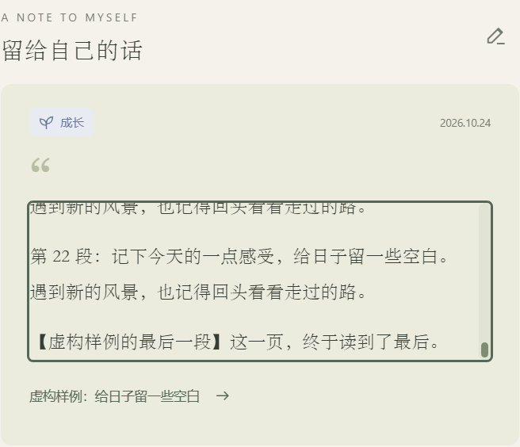

# 留给自己的话：滚动阅读

日期：2026-10-24 · 版本：v0.0.22

首页“留给自己的话”之前把超出卡片高度的感想隐藏了。现在正文超出时显示纵向滚动条，可以用滚轮或拖动滑块读到最后，也支持聚焦后的键盘滚动。普通文字和 Markdown 段落都完整保留，短感想自然显示。

卡片正文用于阅读和选择文字；底部日子标题、右上角编辑按钮分别进入原来的详情编辑器。滚动和拖动滑块不会误开编辑。日期、分类、字体和颜色保留，实际记录没有数据迁移。

生产构建、浏览器和 Windows WebView2 独立测试通过：22 段虚构感想可用滚轮、Home / End 和拖动滚动条读到最后，两个编辑入口都能打开完整原文，阅读后存储内容不变。另核对短感想、旧普通文字及 320 / 390 / 768 / 1440 宽度无页面横向溢出。Windows 截图如下，内容为虚构样例。

