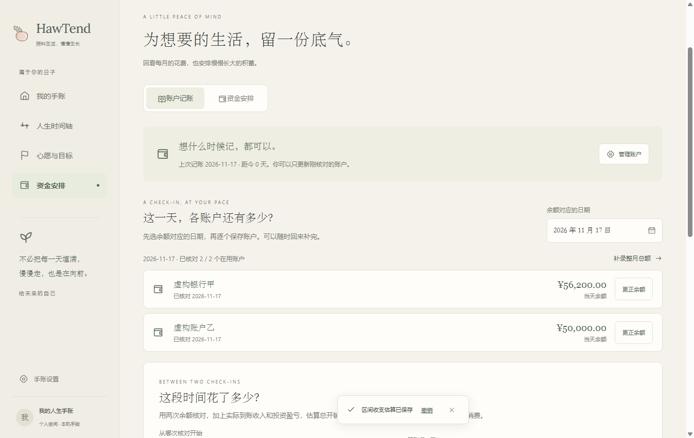
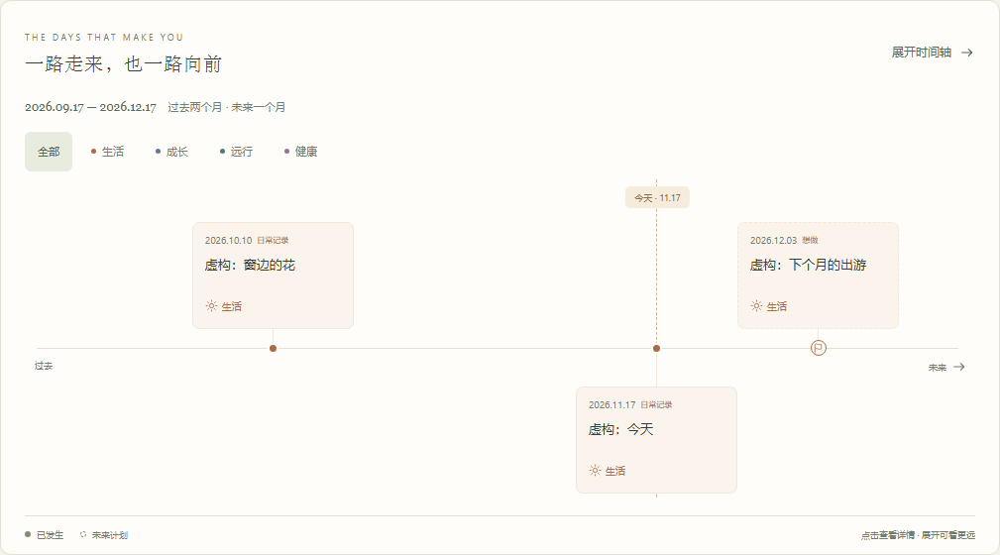

# 账户记账、25 天提醒与近三个月时间轴

2026-11-17 · v0.0.23

## 按各账户保存

从“资金安排 → 账户记账”进入。先选余额对应的任意日期，再选择一家银行、微信或支付宝保存。无需一次填完全部账户。日期保留在页面中，便于随后记其他账户；下次也可选择旧日期接着补齐。

只有一项余额的账户可直接改金额；账户有多项资产就分项核对，合计自动相加。有买入、赎回和现金分红的手动市值资产，可以填写从上一条市值记录起的资金进出。同日再次保存是更正该账户日期，不会重复累加。正常核对同时更新该账户的资产明细；也可只存当天总额。早于已有较新记录的日期和已归档账户只允许补录总额，不覆盖当前资产。到期存款的类型变更仍在资金安排里处理。

## 两次余额之间的收支

在两个日期都有完整、可比较的账户快照后，填写实际到账收入和实际投资净收益（含净亏损、实际利息，不用规划的年化收益）。两端日期都匹配时可带入已有基金盈亏，再补齐未覆盖的部分。若有信用卡或其他欠款，填写两端欠款。净资产＝账户总额减欠款；估算支出＝期初净资产＋实际收入＋投资净收益－期末净资产。

第一次先建基准；历史余额已知时可直接补录。账户不齐、区间不匹配、差额为负时不给出可保存的支出。新开或关闭账户确认余额为零时可明确补 0；移除空账户仍保留历史。各快照的覆盖范围应一致，同一份钱不重复计入。记录保存为区间估算，与原手填月度记录分开；更正快照后可重新确认该区间。不会借此推断明细、实际消费分类，或者把任意区间当作完整自然月给现有工资规划使用。

## 打开应用时提醒

从新版第一次成功保存记账起，用本地日期数满 25 天。打开应用弹出小提示，可去记账或稍后再记。稍后仅关闭本次提示，下一次打开仍会提示；任何一次成功保存账户余额、区间估算或手填月结都会重新计时。新旧记录日期与实际操作日分别保存，补录历史账也按操作日计时。旧版未保存操作日的历史不会被用来猜日期。

## 首页时间范围

首页以当天为准，显示前两个月的已发生日子与后一个月的目标，今天约在三分之二位置，密集日期可通过聚合展开。首页不再从最早日子起显示；“展开时间轴”保留完整的浏览和缩放。

构建、账户与日期计算、旧数据校验通过。使用虚构记录在浏览器和 Windows WebView2 验证分账户更新、历史补录、实际收入与欠款计算、旧月结保留、24/25 天边界、稍后与重新打开、保存后重置、首页范围与完整时间轴入口。Windows 重复启动已有窗口也会提醒。另检查 320 / 390 / 768 / 1440 浏览器宽度；未验证 iPhone 实机。
